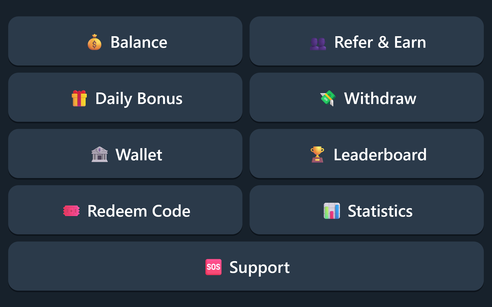

# 💸 INR Refer & Earn Telegram Bot

An advanced refer-and-earn Telegram bot built with Node.js. Users earn Indian Rupees (₹) for inviting friends, can claim a daily bonus and redeem gift codes, and withdraw to their UPI ID. A **one-device-one-account** system blocks fake referrals, and a full web admin panel lets you run everything from your browser.

**Stack:** Node.js 20+ · Telegraf · Express · Cloudflare D1 (database) · Cloudflare R2 (file storage) · Render (or any Node.js host)



> 📄 **New to hosting?** Read **[SETUP_GUIDE.txt](SETUP_GUIDE.txt)**. It explains every step, from creating the bot to going live, and tells you where to get each value.

---

## ✨ Features

### For users (inside Telegram)
| Feature | Details |
|---|---|
| 👥 Refer & Earn | A personal referral link and a Share button. The referrer is paid only after the new user has joined the required channels **and** verified their device. |
| 🛡 One device = one account | A Telegram Mini App builds a device fingerprint (a SHA-256 hash of canvas, WebGL, audio, screen, hardware and timezone signals) plus a persistent device token. A device that is already linked to another account is rejected. |
| 📢 Force-join channels | Supports any number of channels or groups, with an "I've Joined" check button. |
| 💰 Wallet | Shows balance, total earned, total withdrawn, pending referrals and transaction history. |
| 💸 UPI withdrawals | Minimum and maximum amounts, a minimum number of referrals, a percentage fee, quick-amount buttons and a confirmation screen. Each user can have only one pending request at a time. |
| 🎁 Daily bonus | A random amount between a minimum and a maximum, with a 24-hour cooldown. |
| 🏅 Milestone bonuses | Extra rewards at referral counts you choose, for example 10 → ₹20 and 50 → ₹150. |
| 🎟 Gift codes | Promo codes with an amount, a usage limit and an optional expiry. |
| 🏆 Leaderboard & 📊 Stats | The top referrers, the user's own rank, and public bot statistics. |
| 🔔 Notifications | Users are notified when someone joins with their link, when a referral is confirmed, and when a payout is paid or rejected. |

### For admins
- **Web admin panel at `/admin`**
  - **Dashboard:** live stats and a 14-day sign-up chart.
  - **Users:** search, filters and sorting, plus a detail page where you can add or deduct balance, ban or unban, reset the device link, edit the UPI ID and send a message.
  - **Withdrawals:** pending, paid and rejected tabs. Mark a request as paid (with a UTR number) or reject it with an automatic refund. Export to CSV for bulk payouts.
  - **Broadcast:** send text, an image and a button to all users, with live progress, a test send to admins and a stop button.
  - **More pages:** gift codes, anti-fraud logs, all transactions and every setting.
  - **Backups:** the full database is backed up to Cloudflare R2 automatically every 24 hours, or on demand.
- **In-bot admin tools**
  - `/admin` shows quick stats.
  - Each new withdrawal is sent to the admins with **✅ Mark Paid / ❌ Reject** buttons.
- **Security**
  - Signed HttpOnly session cookies, protected against cross-site requests (SameSite + origin check).
  - Admin login locks for 15 minutes after 5 failed attempts.
  - Telegram webhooks are checked with a secret token, and Mini App data is verified with HMAC.
- **Money handling**
  - Amounts are stored as integer paise, so there are no rounding errors.
  - Every balance change is an atomic, conditional database update. This prevents double withdrawals, double claims and negative balances.

---

## 🚀 Quick start

```bash
git clone https://github.com/<you>/rfinfo.git
cd rfinfo
npm install
cp .env.example .env      # fill in the values (see SETUP_GUIDE.txt)
npm run check             # tests Telegram, D1 and R2 connections
npm start
```

When `PUBLIC_URL` is empty, the bot uses **long polling**, which is convenient for local testing. Device verification needs a public HTTPS URL, so either turn off **Require device verification** in the admin settings while testing locally, or expose your machine with a tunnel such as ngrok and set `PUBLIC_URL`.

---

## 🔧 Environment variables

| Variable | Required | Description |
|---|---|---|
| `BOT_TOKEN` | ✅ | Bot token from @BotFather |
| `ADMIN_IDS` | Recommended | Comma-separated Telegram user IDs that receive admin alerts |
| `ADMIN_USERNAME` | — | Admin panel username (default: `admin`) |
| `ADMIN_PASSWORD` | ✅ | Admin panel password |
| `SESSION_SECRET` | Recommended | A long random string used to sign admin sessions |
| `PUBLIC_URL` | Host-dependent | The public HTTPS URL of your app. Detected automatically on Render, Railway and Koyeb. |
| `CF_ACCOUNT_ID` | ✅ \* | Cloudflare account ID |
| `CF_API_TOKEN` | ✅ \* | Cloudflare API token with **D1 Edit** permission |
| `D1_DATABASE_ID` | ✅ \* | ID of your D1 database |
| `D1_PROXY_URL` | Optional \* | URL of the optional D1 proxy Worker (for high traffic) |
| `D1_PROXY_SECRET` | Optional \* | Shared secret for the proxy Worker |
| `R2_ACCESS_KEY_ID` | Optional | R2 API token access key |
| `R2_SECRET_ACCESS_KEY` | Optional | R2 API token secret key |
| `R2_BUCKET` | Optional | R2 bucket name |
| `R2_PUBLIC_URL` | Optional | Public bucket URL, needed for welcome-banner uploads |
| `R2_ACCOUNT_ID` | Optional | Defaults to `CF_ACCOUNT_ID` |

\* For the database, set **either** `CF_ACCOUNT_ID` + `CF_API_TOKEN` + `D1_DATABASE_ID` (REST API) **or** `D1_PROXY_URL` + `D1_PROXY_SECRET` (proxy Worker).

Without R2 the bot works normally. Only backups and image uploads are disabled.

---

## ☁️ Hosting

This is a standard long-running Node.js web server, so it runs on **any host that supports Node.js 20+ and gives you a public HTTPS URL**:

| Host | Notes |
|---|---|
| **Render** | One-click deploy using `render.yaml`. The URL is detected automatically. |
| **Railway** | Generate a public domain. The URL is detected automatically. |
| **Koyeb** | The URL is detected automatically. |
| **Fly.io / Northflank / Heroku** | Set `PUBLIC_URL` to your app URL. |
| **VPS** (DigitalOcean, Hetzner, AWS EC2, etc.) | Run with `pm2` behind Nginx or Caddy with HTTPS, and set `PUBLIC_URL`. |

❌ **Not supported:** serverless or edge-only platforms such as Vercel, Netlify Functions and Cloudflare Workers. The bot needs a process that stays running, because it sends broadcasts in the background and runs scheduled backups.

On startup the app creates the database tables, registers the Telegram webhook at `PUBLIC_URL`, and serves the admin panel at `PUBLIC_URL/admin`.

### High traffic: the D1 proxy Worker
The Cloudflare REST API is limited to about 1,200 requests per 5 minutes. For large bots, deploy the included Worker (`cloudflare-worker/`) and use `D1_PROXY_URL` + `D1_PROXY_SECRET` instead. Step-by-step instructions are in SETUP_GUIDE.txt (Part 9).

---

## 🛡 How one-device-one-account works

1. A user opens `/start <referrer_id>`, and the referral is saved as **pending**.
2. The user joins the required channels, then taps **🔐 Verify My Device**, which opens a Telegram Mini App.
3. The Mini App builds a hardware fingerprint and device token. The server verifies the Telegram `initData` signature, so requests cannot be forged.
4. If the same fingerprint or token already belongs to another account:
   - with **Auto-ban duplicates** on, the new account is banned and the referrer gets nothing;
   - with it off, the user may use the bot, but the referrer still gets nothing.
   - Every attempt is recorded on the **Anti-Fraud** page.
5. Otherwise the referrer is credited, plus any milestone bonus, and both users are notified.

Two identical phone models can occasionally produce the same fingerprint. If a genuine user is blocked, open their page in the admin panel and click **Unban** and **Reset device**.

---

## 📁 Project structure

```
src/
  index.js              Express server, webhook setup, startup
  config.js             Environment configuration
  utils.js              ₹ formatting, HTML escaping, UPI validation
  db/d1.js              D1 client (REST API or proxy Worker, with retries)
  db/repo.js            All queries, atomic money operations, settings
  storage/r2.js         R2 client (S3-compatible API)
  bot/handlers.js       Bot commands, menus and flows
  bot/ui.js             Keyboards and shared screens
  services/             Referrals, withdrawals, broadcasts, backups, channel checks
  web/verify.js         Device-verification Mini App and API
  admin/                Admin panel (auth, layout, routes)
schema.sql              Database schema
cloudflare-worker/      Optional D1 proxy Worker
render.yaml             Render blueprint
SETUP_GUIDE.txt         Complete step-by-step hosting guide
```

## 📜 Scripts

| Command | Purpose |
|---|---|
| `npm start` | Start the bot |
| `npm run dev` | Start with auto-restart on file changes |
| `npm run check` | Test the Telegram, D1 and R2 connections |
| `npm run migrate` | Create the database tables manually (also runs automatically on start) |
